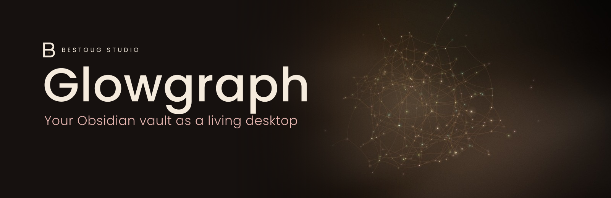
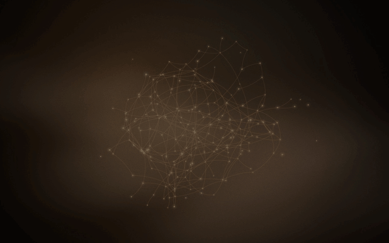
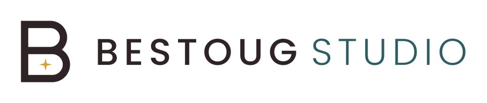

<p align="center">
  
</p>

<p align="center">
  <b>Your Obsidian vault as a living, glowing desktop on the Mac.</b><br>
  Native, quiet, private. Built for people who keep their notes open all day and like to look at them.
</p>

<p align="center">
  <a href="https://github.com/Bestoug/glowgraph/releases/latest"><b>Download for macOS</b></a> ·
  <a href="#features">Features</a> ·
  <a href="#performance">Performance</a> ·
  <a href="#privacy">Privacy</a> ·
  <a href="#install">Install</a> ·
  <a href="#deutsch">Deutsch</a>
</p>

<p align="center">
  
  <br><sub>Example vault with invented notes. Real speed, recorded from the app's own renderer.</sub>
</p>

---

## What it is

Glowgraph turns the graph of your [Obsidian](https://obsidian.md) vault into your desktop. Every note becomes a soft point of light, and every `[[link]]` becomes a thin thread that sparks run along. The whole sculpture turns slowly, like a lantern.

The picture is not a screenshot. It reads your vault folder directly and keeps up with you, so the desktop grows a little every time you write.

It's a small native Mac app, under 2 MB, that lives in your menu bar. It doesn't need Obsidian to be running, and it never touches the network.

## Why another wallpaper app?

Live wallpapers usually play a video or render a web page behind your windows. A web page in particular keeps a whole browser engine busy all day. That costs memory and battery for something you mostly see out of the corner of your eye.

Glowgraph draws directly with Apple's Metal at a calm 30 frames per second. It stops drawing completely whenever your desktop is covered, and it uses a fraction of the resources. See the [measurements](#performance) below.

## Features

### A desktop that grows with your notes
- **Live**: new notes and links show up within seconds. There is nothing to export or refresh.
- **New notes glow up**: a fresh note lights up softly and settles in. Several new notes take turns, and a brand-new folder glows a little brighter.
- **Brightness by content**: longer notes shine a bit brighter and larger. The range is capped, so one giant note never outshines everything else.
- **Stable layout**: each note keeps its place between restarts, so your sculpture stays recognisable. A note that gets its first link finds its spot in the web.
- **Lonely notes stay visible**: notes without any links form a loose ring around the sculpture.
- **Colour by folder**: each top-level folder gets its own calm colour from a fixed palette.

### Made to stay in the background
- **Works around the menu bar and the Dock**: the sculpture centres itself in the free area of each screen. When the Dock moves to another display, it glides over slowly instead of jumping.
- **Every display**: one view per screen. It only rebuilds when your screens really change, not on every Dock wobble.
- **Pauses when hidden**: nothing is drawn while a full-screen app or your windows cover the desktop.
- **Built-in screen saver**: after 2, 5, 10, 15 or 30 minutes idle (your choice), with a gentle fade. It won't start while a video keeps the display awake, and any key or mouse movement ends it.
- **Lock screen too**: Glowgraph sets a still image of your vault as the real desktop picture, so the lock screen shows your notes instead of black. It is refreshed at most every 10 minutes and only the last two images are kept.
- **Open at login**: one tick in the menu.

### Respectful by design
- **No network access at all**: no account, no analytics, no update pings.
- **Read-only**: it reads `.md` files and never writes to your vault.
- **Small and native**: Swift and Metal, no Electron and no web view. The app is under 2 MB.
- **English and German**: the menu follows your system language.

## Performance

Measured with macOS Activity Monitor on a MacBook Pro (Apple silicon) with a real vault of about 260 notes. All figures are from the author's machine and are not a benchmark suite.

| | Memory | CPU | Setup |
|---|---|---|---|
| **Glowgraph** | **70–72 MB** | **≈ 2.5–9 %** | 30 fps; one display at the low end, MacBook display plus an external 2560×1440 screen at the high end |
| Same graph rendered in a web view (WebKit) | ≈ 350 MB | ≈ 72 % | 60 fps, the author's earlier web-based version |
| Same graph as a web page through a website-wallpaper app | ≈ 794 MB | ≈ 37 % (graphics process) | before switching to Glowgraph |

CPU is the share of one core, taken as CPU time over several minutes. Some figures were measured with the identical renderer shortly before the app got its public name; the latest run of Glowgraph itself came out at about 4 % CPU and 5 % GPU. Memory is "Physical memory" in Activity Monitor's process info. The two-display number covers both screens together, since each display gets its own view.

## Privacy

- **Reads** only the vault folder you choose, plus Obsidian's own list of vaults (`~/Library/Application Support/obsidian/obsidian.json`), which it uses to find your vault automatically.
- **Writes** only:
  - its settings,
  - the remembered positions of the points (`~/Library/Application Support/Glowgraph/`),
  - a small log with times and counts and no note names,
  - the still images (`~/Pictures/Glowgraph/`).
- **Note contents** are only scanned for `[[links]]` and are never stored anywhere.
- **Network**: none. You can check: the code has no networking at all.

## Install

1. Download **Glowgraph.zip** from the [latest release](https://github.com/Bestoug/glowgraph/releases/latest) and unzip it.
2. Move **Glowgraph.app** into your *Applications* folder.
3. Open it. Glowgraph isn't notarized by Apple yet, so macOS will refuse the first time. Open **System Settings → Privacy & Security**, scroll down and click **Open Anyway** next to Glowgraph. You only need to do this once.
4. A small lantern appears in your menu bar. Glowgraph picks the vault Obsidian last had open. To use a different one, choose **Vault → Choose folder …**.
5. Optional: tick **Open at login**.

**Requirements:** macOS 14 Sonoma or newer and a Mac with Apple silicon (M1 or later).

## The menu

| Item | What it does |
|---|---|
| *Vault name: number of notes* | Shows what Glowgraph is reading. |
| Vault | Switches between the vaults Obsidian knows, or picks any folder. |
| Screen saver | Off, or after 2–30 minutes idle. *Start now* shows it right away. |
| Refresh still image | Sets a fresh lock-screen image immediately. |
| Open at login | Starts Glowgraph with your Mac. |
| About Glowgraph | Version and licence. |
| Quit Glowgraph | Closes the app. |

## How the graph is built

- **Links** are counted the way Obsidian counts them: both [[wikilinks]] (with folders, aliases and headings) and standard Markdown links to your notes. Links to websites and links inside code blocks are ignored.
- **Hidden folders** such as `.obsidian`, `.trash` and `.git` are skipped.
- **Brightness and size** come from a note's length, on a log scale between the 10th and 95th percentile of your vault.
- **The layout** is a small force simulation (repulsion, springs and a pull to the centre), computed once and then remembered.
- **Changes** are picked up with a cheap check of file names, sizes and dates every 15 seconds. Only when something changed are the notes read again, in the background.

## Build it yourself

All you need is Apple's command line tools (`xcode-select --install`). No Xcode project is required.

```sh
git clone https://github.com/Bestoug/glowgraph.git
cd glowgraph
./bauen.sh build
open build/Glowgraph.app
```

A small self-test checks the vault reader against an invented example vault:

```sh
xcrun swiftc -O Quellen/Kern/*.swift Werkzeuge/vaultpruefung/main.swift -o vaultpruefung && ./vaultpruefung
```

## FAQ

**Is this an Obsidian plugin?**
No. It's a separate Mac app that reads the same folder Obsidian uses, so it works even while Obsidian is closed.

**Will it slow down my Mac or drain my battery?**
It's designed not to: 30 fps, no drawing while the desktop is hidden, and no web engine. See the [numbers](#performance).

**Does it work with iCloud, Obsidian Sync or Git?**
Yes. Glowgraph just reads the local folder, however it gets synced.

**Big vaults?**
Up to 20,000 notes are read. Very large vaults should work, but they've only been tested with a few hundred notes so far, so feedback is welcome.

**Intel Macs or Windows?**
Not yet.

## Licence

MIT, see [`LICENSE`](LICENSE). Use it, change it, share it.

Glowgraph is an independent project. It is not affiliated with or endorsed by Obsidian. "Obsidian" is a trademark of Dynalist Inc.

<p align="center">
  <br>
  <br>
  <sub>Made with care by <b>BestougStudio</b></sub>
</p>

---

## Deutsch

**Dein Obsidian-Vault als lebendiger Schreibtisch auf dem Mac.** Jede Notiz ist ein weicher Lichtpunkt, jeder `[[Link]]` ein feiner Faden, über den Funken wandern. Das Ganze dreht sich langsam wie eine Laterne.

**Warum Glowgraph?** Die meisten Live-Hintergründe spielen ein Video ab oder zeigen eine Webseite. Das hält den ganzen Tag einen Browser beschäftigt. Glowgraph zeichnet direkt mit Metal, ruhig mit 30 Bildern pro Sekunde. Es pausiert, sobald der Schreibtisch verdeckt ist, und braucht rund 70 MB Arbeitsspeicher statt mehrerer hundert, bei wenigen Prozent CPU.

**Was es kann:**
- Neue Notizen erscheinen live und leuchten kurz sanft auf.
- Längere Notizen leuchten etwas heller, aber begrenzt.
- Es weicht Menüleiste und Dock aus und gleitet langsam hinterher, wenn das Dock den Bildschirm wechselt.
- Jeder Bildschirm bekommt eine eigene Ansicht.
- Eigener Bildschirmschoner und ein Standbild für den Sperrbildschirm.
- Kein Netz, kein Konto, keine Statistik. Glowgraph liest nur deinen Vault-Ordner und schreibt nie hinein.

**Installieren:**
1. `Glowgraph.zip` aus dem [neuesten Release](https://github.com/Bestoug/glowgraph/releases/latest) laden und entpacken.
2. `Glowgraph.app` in *Programme* ziehen.
3. Öffnen. Beim ersten Mal unter **Systemeinstellungen → Datenschutz & Sicherheit** auf **Trotzdem öffnen** klicken.
4. Glowgraph sitzt in der Menüleiste und nimmt den Vault, den Obsidian zuletzt offen hatte. Einen anderen wählst du über **Vault → Ordner wählen …**.

Voraussetzung: macOS 14 oder neuer und ein Mac mit Apple-Chip.
